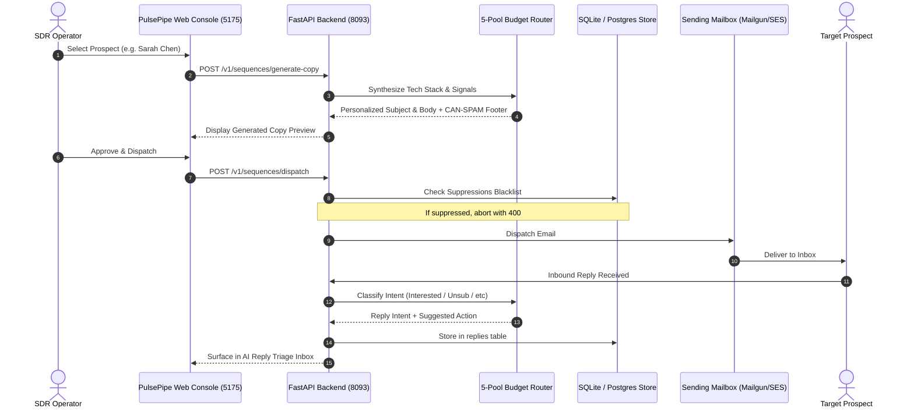

# 🌊 PulsePipe V2 — Technical Flowcharts & Sequence Logic

**Document Version:** 2.0.0 · **Date:** November 2026 · **Author:** Vijay Paliwal (Solution Architect & Lead Developer)

---

## 1. End-to-End SDR Sequence Flow

