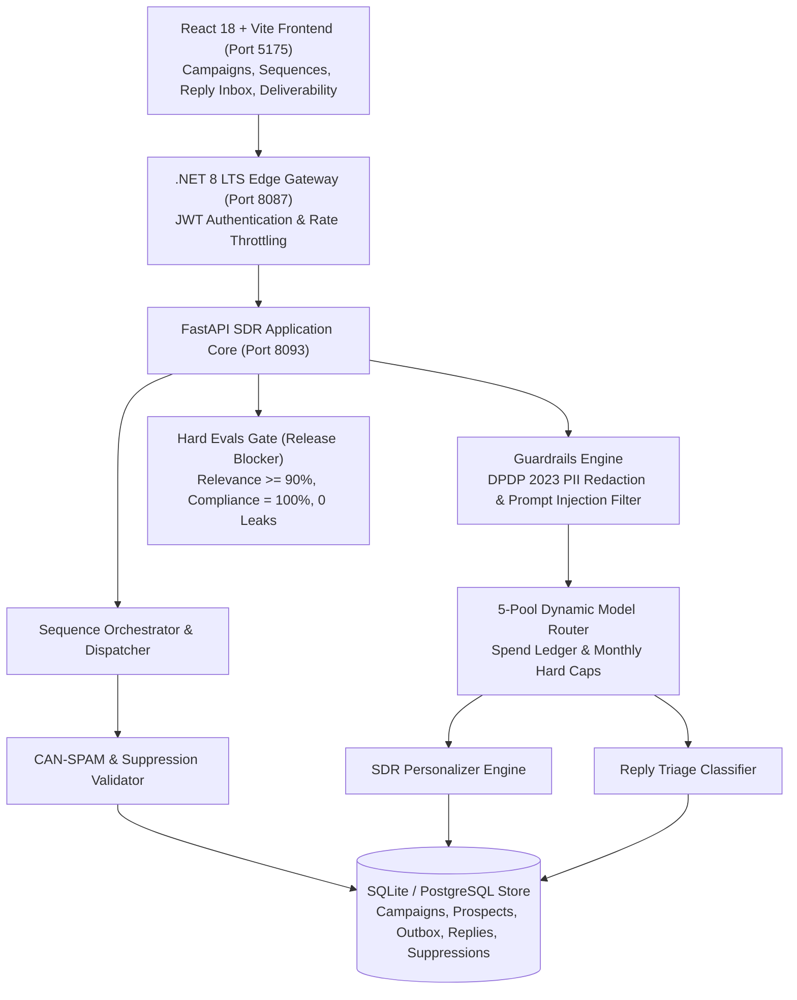

# 🏛️ PulsePipe V2 — System Architecture & Component Diagrams

**Document Version:** 2.0.0 · **Date:** November 2026 · **Author:** Vijay Paliwal (Solution Architect & Lead Developer)

---

## 1. High-Level Architecture Overview

PulsePipe V2 implements the SHIVAM 5-Band Dual-Runtime architecture combining an edge gateway, Python FastAPI business logic core, React 18 modern frontend, and SQLite/PostgreSQL persistent data store.

---

## 2. Component Breakdown

### 2.1 Band 1: Client Presentation Layer
- **Tech Stack:** React 18, Vite 5, React Router 6.
- **Workstations:**
  - *Campaign Hub:* Prospect target lists, signal tags, and instant SDR copy preview.
  - *Sequence Visualizer:* Multi-step timeline editor with delay intervals.
  - *Reply Triage Inbox:* Split-pane view for inbound email analysis and one-click response dispatch.
  - *Deliverability Dashboard:* Real-time SPF/DKIM/DMARC status meters and domain sending volume gauges.
  - *SHIVAM SDR Admin Console:* Sender personas, suppression blacklist, and AI model spend ledger.

### 2.2 Band 2: Edge Gateway Layer
- **Tech Stack:** .NET 8 LTS (`apps/gateway-dotnet/`).
- **Responsibilities:** High-throughput reverse proxy, JWT claim verification, TLS termination, and request rate-limiting.

### 2.3 Band 3: Intelligence & Safety Layer
- **DPDP 2023 Guardrails:** Redacts Indian PAN, Aadhaar, and US SSN identifiers from outbound emails and audit logs.
- **5-Pool Budget Router:** Dynamic cost router managing `ultra-fast`, `balanced`, `high-reasoning`, `economy`, and `offline` LLM pools.

### 2.4 Band 4: Persistence Layer
- **SQLite Engine (`pulsepipe.db`):** WAL-mode SQLite database with foreign-key constraints and dynamic schema migration. Pre-seeded with realistic enterprise B2B prospects (*Stripe, Plaid, Weights & Biases, Brex*).

### 2.5 Band 5: Hard Evals Gate
- **Release Verification Harness (`evals/run_evals.py`):** Runs automated test assertions before deployment:
  - Personalization Relevance: $\ge 90\%$
  - Reply Intent Accuracy: $\ge 90\%$
  - CAN-SPAM Compliance: $100\%$
  - Cross-Tenant Leaks: $0$
